# 🎓 Manual del Estudiante: Capstone Project con Cerebro Digital e Inteligencia Artificial
### *Módulo IMD09 — Proyecto de Grado / Capstone Pregrado (IUB)*
**Institución Universitaria de Barranquilla — Facultad de Ingeniería**

---

## 🌟 1. Introducción y Filosofía de Trabajo

¡Bienvenido al desarrollo de tu Proyecto Capstone! Este manual te guiará paso a paso durante las **16 semanas** del módulo `IMD09 Proyecto de Grado` (314 horas académicas), utilizando una metodología moderna basada en **Cerebro Digital Personal (Obsidian / Markdown)** y el motor agéntico **`llm-wiki` (Multi-IA Universal)**.

### ¿Por qué un Cerebro Digital Compilado con `llm-wiki`?
Los proyectos de ingeniería contemporáneos exigen manejar decenas de artículos científicos, hojas de datos técnicos (*datasheets*), normativas internacionales, modelos matemáticos, códigos de programación y análisis económicos. Tu **Cerebro Digital** es tu bóveda personal donde:
1. **Compilación Continua (Patrón `llm-wiki`)**: A diferencia del RAG tradicional que busca fragmentos al vuelo y olvida, la IA lee tus fuentes en `raw/` y construye de manera acumulativa páginas wiki interconectadas en `wiki/` con conceptos, comparativas y entidades.
2. **Cero Alucinaciones de Ingeniería**: Cualquier modelo de IA (ChatGPT, Claude, Gemini, DeepSeek, Codex, modelos locales en Khoj/Ollama) consulta tu índice estructurado (`index.md`) y tus datos reales, garantizando precisión técnica y matemática.
3. **Memoria de Sesión Persistente**: Puedes pausar tu trabajo y retomarlo días después sin perder el hilo de tus cálculos o decisiones de diseño.
4. **Compilación Fluida a LaTeX**: Al final del semestre, tu documento en LaTeX (`plantilla_iub.tex`) no se escribe desde cero, sino que se compila directamente a partir de las notas consolidadas semana a semana.

---

## 🛠️ 2. Paso 0: Configuración Inicial de tu Cerebro Digital (Día 1)

Sigue estos sencillos pasos para dejar listo tu entorno de trabajo:

### Paso 2.1: Descargar e Instalar Obsidian
1. Descarga e instala **Obsidian** (gratuito) desde [obsidian.md](https://obsidian.md).
2. Abre Obsidian y selecciona **"Open folder as vault"** (Abrir carpeta como bóveda).
3. Selecciona la carpeta [`04_BOVEDA_CEREBRO_DIGITAL_PLANTILLA`](./04_BOVEDA_CEREBRO_DIGITAL_PLANTILLA) contenida en este framework (puedes renombrarla como `mi-capstone-brain`).

### Paso 2.2: Conocer la Estructura de tu Bóveda
Tu bóveda tiene una organización lógica y limpia:

```text
mi-capstone-brain/
├── 📄 SYSTEM_PROMPT.md          <-- Contexto maestro para copiar/pegar en cualquier IA
├── 📄 CLAUDE.md / AGENTS.md     <-- Configuración para agentes autónomos (Claude Code / Codex)
├── 📄 index.md                  <-- Mapa de navegación y catálogo general de la wiki
├── 📄 log.md                    <-- Bitácora de avances semanales y sesiones
├── 📂 00-inbox/                 <-- Captura rápida de ideas y notas de asesoría
├── 📂 raw/                      <-- Fuentes inmutables (Papers, Normas ISO/IEEE, Datasheets)
├── 📂 wiki/                     <-- Estado del arte y conceptos técnicos compilados
├── 📂 05-zettelkasten/          <-- Decisiones de diseño justificadas y fórmulas clave
└── 📂 capstone/                 <-- Capítulos de tu informe en borrador Markdown
    ├── cap1_introduccion/
    ├── cap2_estado_del_arte/
    ├── cap3_gestion_proyecto/
    ├── cap4_resultados/
    └── cap5_conclusiones/
```

### Paso 2.3: Configurar tu Entorno de IA Preferido
Este framework es **100% agnóstico**: puedes usar la IA y la interfaz que prefieras.

| Herramienta | Cómo configurarla con tu Cerebro Digital | Comandos Rápidos `llm-wiki` |
| :--- | :--- | :--- |
| **ChatGPT / Claude.ai / Gemini / DeepSeek (Web)** | Copia y pega el contenido de [`01_SYSTEM_PROMPT_MAESTRO_MULTI_IA.md`](./01_SYSTEM_PROMPT_MAESTRO_MULTI_IA.md). Luego, utiliza los prompts específicos de [`03_PROMPTS_KIT_POR_COMPETENCIA/`](./03_PROMPTS_KIT_POR_COMPETENCIA/). | *Uso manual mediante las fichas de trabajo* |
| **Claude Code (CLI / Plugin nativo)** | Instala el plugin `wiki@llm-wiki` o abre la terminal en la raíz de tu bóveda donde está el archivo `CLAUDE.md`. | `claude` ➔ `/wiki:ingest`, `/wiki:lint`, `/wiki:audit` |
| **OpenAI Codex (CLI / IDE)** | Agrega el plugin `codex plugin add wiki@llm-wiki` desde la terminal. | `@wiki research`, `$wiki-query "término"`, `@wiki audit` |
| **Khoj / Ollama (Offline / Local)** | Apunta Khoj o tu cliente local a la carpeta de tu bóveda para habilitar búsqueda semántica y consultas offline sobre tus notas. | Búsqueda semántica instantánea sobre `raw/` y `wiki/` |

---

## 🗺️ 3. Ruta de Trabajo de 16 Semanas (Fase a Fase)

El desarrollo del proyecto está alineado con los **Resultados de Aprendizaje (RA1 a RA7)**, las **Unidades de Competencia (UC1 a UC4)** de la IUB y los **Student Outcomes ABET (SO1 a SO7)**.

```mermaid
gantt
    title Cronograma General de Capstone (16 Semanas)
    dateFormat  X
    axisFormat  Sem %s
    section Fase 1: Cimientos
    Problema, Objetivos y Requerimientos (RA1, UC1, SO1-SO2) :active, 1, 3
    section Fase 2: Fundamentación
    Estado del Arte, Normas y SO7 (RA6, RA3, SO7, SO4)       : 4, 6
    section Fase 3: Gestión
    Metodología, Gantt 16S y Matriz RACI (RA4, SO5)          : 6, 7
    section Fase 4: Núcleo de Ingeniería
    Modelado Físico-Matemático y Simulación (RA1, UC1, SO1)  : 7, 9
    Diseño Detallado, Planos y AMFE (RA2, RA3, UC2, SO2, SO4): 9, 11
    Validación Experimental y Pruebas (RA5, UC2, SO6)        : 11, 13
    Ingeniería Económica y Costos (RA2, UC1, SO2)            : 13, 14
    section Fase 5: Cierre & LaTeX
    Conclusiones, Resumen Ejecutivo y LaTeX (RA7, SO3)       : 14, 16
```



---

### 📍 FASE 1: Problema, Justificación, Objetivos y Requerimientos (Semanas 1 a 3)
* **Objetivo de Aprendizaje**: Identificar y formular un problema complejo de ingeniería mecatrónica (**RA1, UC1-EC1, EC2, ABET SO1, SO2**).
* **Regla Crítica ABET**: El proyecto debe ser un **Major Engineering Design** (diseño de ingeniería significativo con modelado y dimensionamiento), no un mero mantenimiento o instalación básica.
* **Operaciones `llm-wiki` & Prompts**:
  1. En tu carpeta `capstone/cap1_introduccion/`, abre `01_planteamiento_problema.md`.
  2. Escribe los datos preliminares del problema real detectado en la industria o entorno.
  3. Ejecuta el prompt: [`Prompt_01_Problema_Justificacion_y_Objetivos_RA1_UC1.md`](./03_PROMPTS_KIT_POR_COMPETENCIA/Prompt_01_Problema_Justificacion_y_Objetivos_RA1_UC1.md).
  4. Ejecuta el prompt: [`Prompt_02_Requerimientos_Diseno_y_Restricciones_RA2_UC1_UC2.md`](./03_PROMPTS_KIT_POR_COMPETENCIA/Prompt_02_Requerimientos_Diseno_y_Restricciones_RA2_UC1_UC2.md).
* **Entregable de la fase**: Sección 1.1 a 1.6 completada en Markdown y validada por tu asesor.

---

### 📍 FASE 2: Estado del Arte, Ingesta con `llm-wiki` y Autoformación SO7 (Semanas 4 a 6)
* **Objetivo de Aprendizaje**: Adquirir y aplicar nuevo conocimiento de forma autónoma mediante literatura científica y patentes (**RA6, RA3, UC1, UC3-EC1, ABET SO7, SO4**).
* **Operaciones `llm-wiki` & Prompts**:
  1. Descarga entre **15 y 25 fuentes** (Scopus, IEEE Xplore, Google Patents) y colócalas en `raw/papers/` y `raw/normas_tecnicas/`.
  2. Si usas agentes CLI, ejecuta `@wiki ingest raw/papers/` para compilar automáticamente resúmenes estructurados en `wiki/estado_del_arte/`.
  3. Documenta tu proceso de búsqueda y cribado documental con el prompt: [`Prompt_03b_Metodologia_Bibliometrica_y_Analisis_Bibliografico_RA6_RA3.md`](./03_PROMPTS_KIT_POR_COMPETENCIA/Prompt_03b_Metodologia_Bibliometrica_y_Analisis_Bibliografico_RA6_RA3.md).
  4. Ejecuta el prompt: [`Prompt_03_Estado_del_Arte_Patentes_Normas_y_SO7_RA6_RA3.md`](./03_PROMPTS_KIT_POR_COMPETENCIA/Prompt_03_Estado_del_Arte_Patentes_Normas_y_SO7_RA6_RA3.md).
  5. Documenta en `02_adquisicion_nuevo_conocimiento_SO7.md` qué tecnologías nuevas aprendiste y cómo las aplicaste en el diseño.
* **Entregable de la fase**: Capítulo 2 completo con matriz comparativa multicriterio y marco legal/normativo.

---

### 📍 FASE 3: Gestión del Proyecto, Cronograma y Trabajo en Equipo (Semanas 6 y 7)
* **Objetivo de Aprendizaje**: Planificar tareas, hitos y distribución de roles colaborativos con evaluación entre pares (**RA4, UC1, UC2, UC4, ABET SO5**).
* **Operaciones `llm-wiki` & Prompts**:
  1. Abre `capstone/cap3_gestion_proyecto/`.
  2. Ejecuta el prompt: [`Prompt_04_Gestion_EDT_Gantt16S_RACI_y_Coevaluacion_RA4_ABET_SO5.md`](./03_PROMPTS_KIT_POR_COMPETENCIA/Prompt_04_Gestion_EDT_Gantt16S_RACI_y_Coevaluacion_RA4_ABET_SO5.md).
  3. Define la Estructura de Desglose del Trabajo (EDT/WBS), el diagrama de Gantt de 16 semanas y la matriz RACI.
* **Entregable de la fase**: Capítulo 3 completo con metodología y acuerdos de equipo.

---

### 📍 FASE 4: Resultados — El Núcleo de Ingeniería (Semanas 7 a 14)
Esta fase agrupa el trabajo técnico central del proyecto:

#### 4.1 Modelado Físico-Matemático y Simulación (Semanas 7 a 9)
* **Objetivo**: Formular ecuaciones gobernantes y simular el comportamiento dinámico/estructural (**RA1, UC1-EC3, UC3-EC2, ABET SO1**).
* **Prompt**: [`Prompt_05_Modelado_Fisico_Matematico_y_Simulacion_RA1_UC1_UC3_SO1.md`](./03_PROMPTS_KIT_POR_COMPETENCIA/Prompt_05_Modelado_Fisico_Matematico_y_Simulacion_RA1_UC1_UC3_SO1.md).

#### 4.2 Ingeniería de Diseño Detallado, Planos y AMFE (Semanas 9 a 11)
* **Objetivo**: Desarrollar la arquitectura de subsistemas (mecánico, electrónico, control, software/IA), seleccionar componentes comerciales y realizar análisis de fallas (**RA2, RA3, UC2-EC2, UC3-EC3, UC4, ABET SO2, SO4**).
* **Prompt**: [`Prompt_06_Diseno_Detallado_Arquitectura_y_AMFE_RA2_RA3_UC2_UC4_SO2_SO4.md`](./03_PROMPTS_KIT_POR_COMPETENCIA/Prompt_06_Diseno_Detallado_Arquitectura_y_AMFE_RA2_RA3_UC2_UC4_SO2_SO4.md).
* **Decisiones Atómicas**: Documenta cada decisión crítica en `05-zettelkasten/` usando la plantilla de decisión de diseño.

#### 4.3 Implementación y Validación Experimental (Semanas 11 a 13)
* **Objetivo**: Construir el protocolo de pruebas, registrar datos físicos reales y realizar análisis estadístico contra los requerimientos de diseño (**RA5, UC2-EC3, UC4-EC3, ABET SO6**).
* **Prompt**: [`Prompt_07_Protocolo_Pruebas_Validacion_Estadistica_RA5_UC2_SO6.md`](./03_PROMPTS_KIT_POR_COMPETENCIA/Prompt_07_Protocolo_Pruebas_Validacion_Estadistica_RA5_UC2_SO6.md).

#### 4.4 Ingeniería Económica y Finanzas del Proyecto (Semanas 13 a 14)
* **Objetivo**: Costear prototipo (materiales, mano de obra, indirectos), calcular CAPEX/OPEX y evaluar viabilidad financiera (**RA2, UC1, ABET SO2**).
* **Prompt**: [`Prompt_08_Ingenieria_Economica_Finanzas_y_ROI_RA2_UC1.md`](./03_PROMPTS_KIT_POR_COMPETENCIA/Prompt_08_Ingenieria_Economica_Finanzas_y_ROI_RA2_UC1.md).

---

### 📍 FASE 5: Conclusiones, Auditoría `llm-wiki` y Compilación LaTeX (Semanas 14 a 16)
* **Objetivo de Aprendizaje**: Comunicar efectivamente los resultados del proyecto de ingeniería (**RA5-CA4, RA7-CA1-CA3, ABET SO3**).
* **Operaciones `llm-wiki` & Prompts**:
  1. Redacta conclusiones técnicas cuantitativas (1 por cada objetivo específico).
  2. Genera el **Resumen Ejecutivo** y el **Abstract** (estrictamente entre 150 y 250 palabras con la estructura obligatoria de 5 partes).
  3. Ejecuta el prompt: [`Prompt_09_Conclusiones_Resumen_Abstract_y_LaTeX_RA7_SO3.md`](./03_PROMPTS_KIT_POR_COMPETENCIA/Prompt_09_Conclusiones_Resumen_Abstract_y_LaTeX_RA7_SO3.md).
  4. Realiza una auditoría de consistencia con el comando `@wiki audit` o con el prompt: [`Prompt_10_Auditor_Pre_Entrega_ABET_y_Microcurriculo.md`](./03_PROMPTS_KIT_POR_COMPETENCIA/Prompt_10_Auditor_Pre_Entrega_ABET_y_Microcurriculo.md).
  5. Compila tu archivo final en [`05_ENTORNO_LATEX_IUB/plantilla_iub.tex`](./05_ENTORNO_LATEX_IUB/plantilla_iub.tex) (en Overleaf o distribución local LaTeX).

---

## 🚦 4. Reglas de Oro para Trabajar con IA en tu Capstone

1. **Tú eres el ingeniero; la IA es tu copiloto**: La IA no conoce tus mediciones experimentales ni los precios de tus proveedores locales en Barranquilla. Tú debes suministrar los datos reales.
2. **Prohibido el lenguaje subjetivo**: Evita frases como *"funciona de manera excelente"* o *"es muy rápido"*. La plantilla institucional y ABET exigen datos numéricos (ej. *"tiempo de respuesta de 142 ms con desviación estándar de 8.3 ms"*).
3. **Trazabilidad 100%**: Ninguna ecuación, norma o componente debe aparecer sin su fuente o justificación técnica registrada en tu carpeta `raw/`.
4. **Validación cruzada**: Siempre revisa las ecuaciones y el código generado antes de integrarlo a tu documento final.
