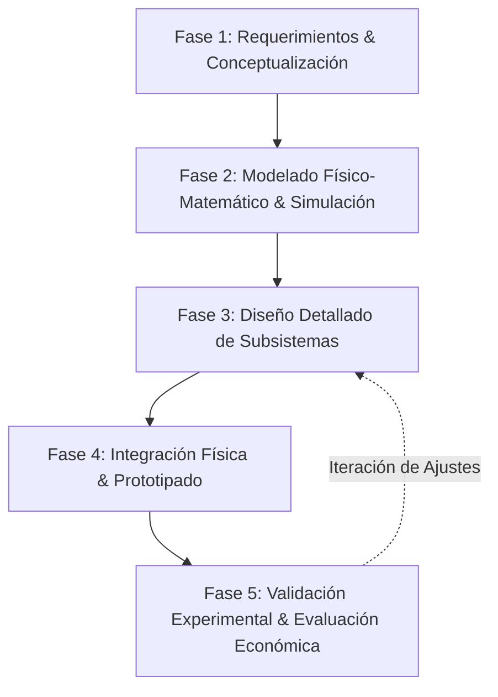

# 3.1 Metodología de Ingeniería

## 🔄 Enfoque Metodológico
Para el desarrollo de este proyecto se adopta la metodología de diseño mecatrónico basada en la norma **VDI 2206 / Ciclo en V**, estructurada en cinco fases secuenciales e iterativas:

### Descripción de las Fases:
1. **Fase 1 (Semanas 1-3)**: Levantamiento de necesidades en planta, definición de la pregunta problema, objetivos y matriz de requerimientos y restricciones reales.
2. **Fase 2 (Semanas 4-6)**: Revisión del estado del arte, búsqueda de patentes, identificación de normas técnicas y deducción analítica de ecuaciones gobernantes.
3. **Fase 3 (Semanas 7-10)**: Simulación computacional (CAD/FEA/CFD), selección de componentes con catálogo comercial, planos de fabricación y matriz AMFE.
4. **Fase 4 (Semanas 11-13)**: Manufactura y ensamble del prototipo, cableado de potencia y control, y programación de firmware embebido.
5. **Fase 5 (Semanas 14-16)**: Ejecución del protocolo experimental, análisis estadístico de repetibilidad, costeo final y compilación del informe en LaTeX.
