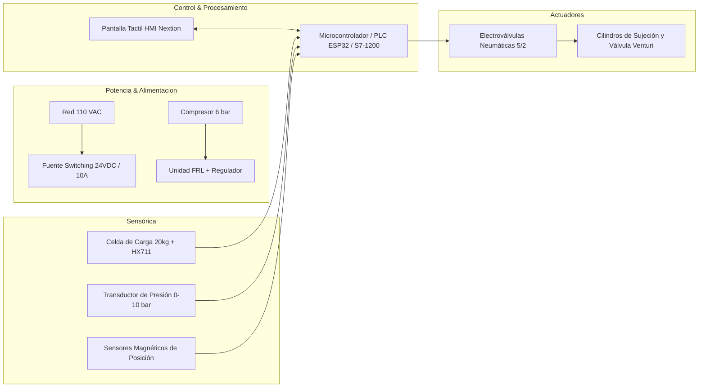

# 4.2.1 Arquitectura Mecatrónica y Desglose de Subsistemas (ABET SO2)

## 🖧 Diagrama de Bloques Funcional de la Solución

## ⚙️ Descripción de Subsistemas
1. **Subsistema Mecánico y Estructural**: Chasis en perfilería de aluminio estructural 40x40 mm con cerramiento en acrílico transparente para contención de partículas.
2. **Subsistema Neumático**: Circuito de actuación con electroválvulas monoestables y biestables, válvula de escape rápido y sistema de eyección Venturi.
3. **Subsistema Eléctrico y Electrónico**: Cuadro eléctrico con protecciones termomagnéticas, parada de emergencia categoría 3 y aislamiento galvánico de señales analógicas.
4. **Subsistema de Control y Software/IA**: Máquina de estados finitos programada en C++/Structured Text, con lazo de dosificación por pesaje continuo y filtrado digital de ruido.
