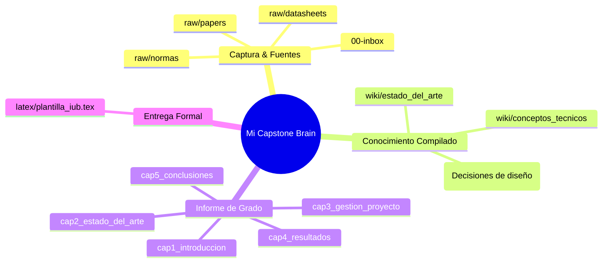

# 🧠 Bóveda: Segundo Cerebro para Capstone Project (IUB)
> **Bienvenido a tu Bóveda de Conocimiento para el Proyecto de Grado Pregrado (IMD09)**.

---

## 🗺️ Mapa de Navegación del Cerebro Digital

---

## 📂 Accesos Rápidos a Capítulos y Secciones

### 📘 Capítulo 1: Introducción & Requerimientos
* [[capstone/cap1_introduccion/01_planteamiento_problema|01. Planteamiento del Problema]]
* [[capstone/cap1_introduccion/02_justificacion|02. Justificación (Importancia, Beneficios, Relevancia IUB, Impactos)]]
* [[capstone/cap1_introduccion/03_objetivos|03. Objetivos General y Específicos]]
* [[capstone/cap1_introduccion/04_alcances_y_limitaciones|04. Alcances y Limitaciones]]
* [[capstone/cap1_introduccion/05_requerimientos_diseno|05. Requerimientos de Diseño y Restricciones (ABET SO2)]]

---

### 📚 Capítulo 2: Estado del Arte y Estándares
* [[capstone/cap2_estado_del_arte/01_soluciones_existentes_y_patentes|01. Soluciones Existentes y Patentes]]
* [[capstone/cap2_estado_del_arte/02_adquisicion_nuevo_conocimiento_SO7|02. Adquisición de Nuevo Conocimiento (ABET SO7)]]
* [[capstone/cap2_estado_del_arte/03_normatividad_aplicable|03. Normas Técnicas y Marco Legal (ABET SO4)]]
* [[capstone/cap2_estado_del_arte/04_matriz_comparativa_critica|04. Matriz Comparativa Multicriterio]]

---

### ⏱️ Capítulo 3: Gestión del Proyecto
* [[capstone/cap3_gestion_proyecto/01_metodologia_y_fases|01. Metodología de Ingeniería y Diagrama de Fases]]
* [[capstone/cap3_gestion_proyecto/02_cronograma_16_semanas_y_wbs|02. EDT / WBS y Cronograma Gantt de 16 Semanas]]
* [[capstone/cap3_gestion_proyecto/03_distribucion_roles_raci_y_coevaluacion|03. Matriz RACI y Coevaluación de Equipo (ABET SO5)]]

---

### ⚙️ Capítulo 4: Resultados (El Núcleo de Ingeniería)
* [[capstone/cap4_resultados/4.1_modelado_y_simulacion/modelado_ecuaciones_y_simulaciones|4.1 Modelado Físico-Matemático y Simulación (ABET SO1)]]
* [[capstone/cap4_resultados/4.2_diseno_detallado/arquitectura_mecatronica_y_subsistemas|4.2.1 Arquitectura Mecatrónica y Subsistemas (ABET SO2)]]
* [[capstone/cap4_resultados/4.2_diseno_detallado/seleccion_componentes_y_planos|4.2.2 Selección de Componentes y Planos]]
* [[capstone/cap4_resultados/4.2_diseno_detallado/amfe_y_responsabilidad_etica_SO4|4.2.3 Análisis de Modos de Falla AMFE y Ética (ABET SO4)]]
* [[capstone/cap4_resultados/4.3_validacion_experimental/protocolo_pruebas_y_montaje|4.3.1 Protocolo Experimental e Instrumentación]]
* [[capstone/cap4_resultados/4.3_validacion_experimental/analisis_estadistico_vs_requerimientos|4.3.2 Análisis Estadístico vs Requerimientos (ABET SO6)]]
* [[capstone/cap4_resultados/4.4_ingenieria_economica/costos_capex_opex_y_retorno|4.4 Costos, Presupuesto y Retorno de Inversión (ABET SO2)]]

---

### 🎯 Capítulo 5: Conclusiones y Cierre
* [[capstone/cap5_conclusiones/01_conclusiones_cuantitativas|01. Conclusiones Cuantitativas por Objetivo]]
* [[capstone/cap5_conclusiones/02_limitaciones_solucion|02. Limitaciones de la Solución Real]]
* [[capstone/cap5_conclusiones/03_recomendaciones_futuras|03. Recomendaciones para Trabajos Futuros]]
* [[capstone/cap5_conclusiones/04_resumen_y_abstract|04. Resumen Ejecutivo y Abstract Oficial (ABET SO3)]]

---

## 📜 Bitácora de Trabajo
Consulta [[log|la Bitácora Semanal (log.md)]] para registrar avances y acuerdos de asesoría.
